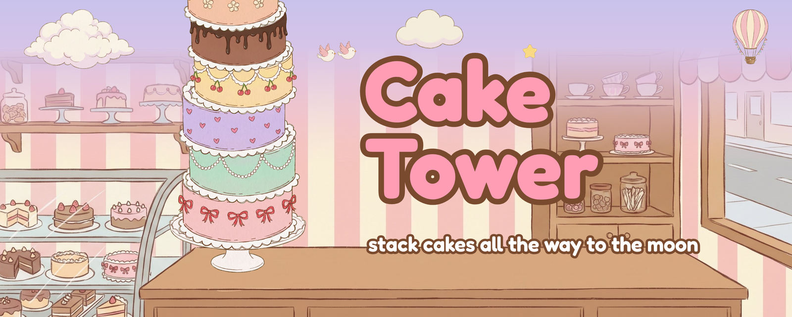
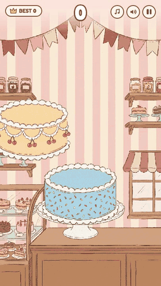
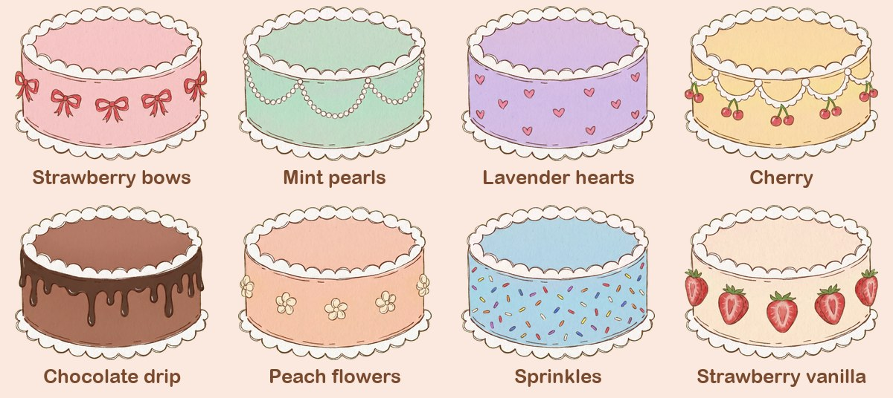
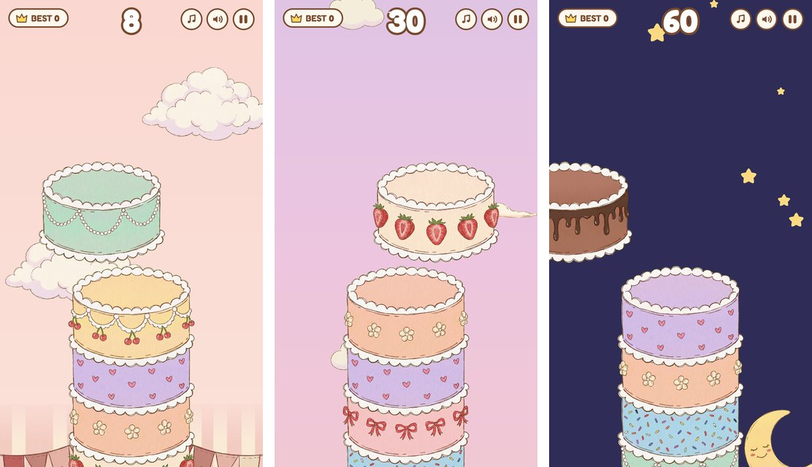
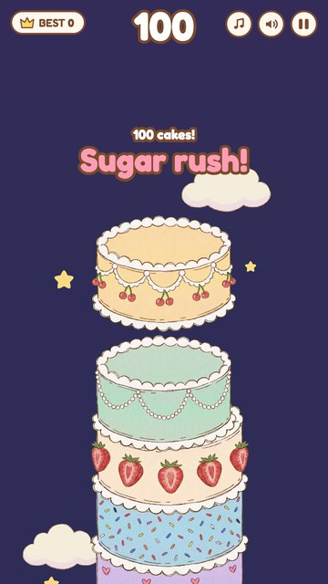
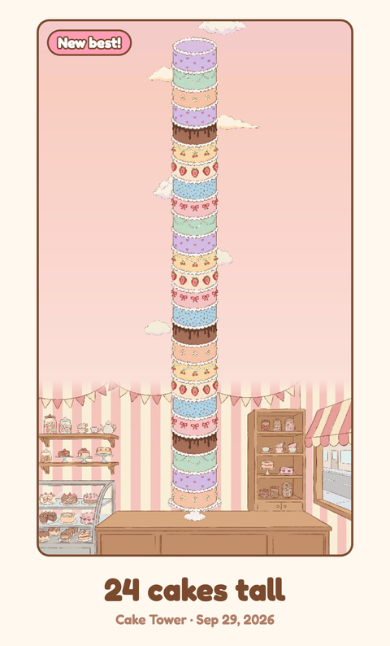
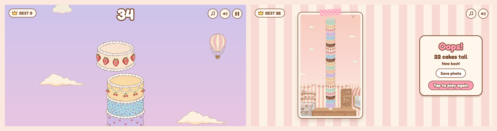

# 🍰 Cake Tower

A cozy **cake-stacking browser game**. Drop each sliding cake onto the tower, keep the layers lined up and build it from the cake shop counter up past the clouds, the balloons and the moon. When a cake finally misses, the camera pulls back and you get a photo of your whole tower.



**[▶ Play Cake Tower on itch.io](https://gianneangely.itch.io/cake-tower)**: free, right in your browser, on desktop or phone. Follow on itch to hear about updates!

<p align="center">
  
</p>

## How to play

1. Tap, click or press **Space** / **Enter** to drop the sliding cake.
2. Anything that hangs over the edge is cut off, so the next cake is a little smaller.
3. Land a cake exactly on top for a **Perfect**. Three Perfects in a row and the cake starts growing back.
4. Keep stacking until a cake misses the tower, then save or share the photo of what you built.

Your best score is kept on your device.

## Eight cakes



Every tier is one of eight hand-painted cakes, in pastel colours with piped borders. They come in a shuffled order, so every tower looks different.

## A sky that changes as you climb



- **The shop**: the first cakes sit on a cake stand on the shop counter, with bunting behind
- **Day**: clouds drift and little birds fly past
- **Dusk** (from about 22 cakes): pink and lilac skies, hot-air balloons
- **Night** (from about 44 cakes): navy sky, twinkling stars, a sleepy moon and a planet

Everything you passed stays in the sky, so the final photo shows the whole climb.

## Balloon cakes and the Sugar Rush



- **Balloon cakes**: from 40 cakes, some cakes swing in hanging under a balloon. They keep part of their sideways speed when you let go, so drop a little early. The balloon floats away when the cake lands.
- **Sugar Rush!**: at **100 cakes** a banner pops up and the game gets harder for real: the cakes slide faster, Perfects get stricter (the small extra leeway for tiny cakes fades out) and balloon cakes come more often. A Perfect streak still grows the cake back, just more slowly.

<br clear="right">

## The tower photo

<p align="center">
  <br>
  <sub>The photo you get from <b>Save photo</b></sub>
</p>

When the game ends the camera pulls back to frame the whole tower, sky and all. **Save photo** downloads it as a card with your score and the itch.io link; **Share** opens your phone's share sheet. Tall towers make taller, narrower photos so every cake still fits.

## More to see



- **Any screen**: portrait or landscape, phone or desktop, it reflows as you rotate
- **Music-box soundtrack**: music and sound effects are synthesized live in the browser with Web Audio; the tune slows down at night. Separate music and sound buttons
- **Pause** any time, and the game pauses itself when you switch tabs
- **Works offline**: no server and no downloads after the page loads

## Run locally

```bash
git clone https://github.com/GianneAngely/cake-tower.git
cd cake-tower
open index.html
```

There is no build step: the game runs straight from the file, offline too.

Handy URL parameters for testing:

- `?demo=perfect` — the game plays itself, landing Perfects
- `?demo=high&n=60` — start from a 60-cake tower (try `n=99` to see the Sugar Rush)
- `?swing` — from 40 cakes on, every cake is a balloon cake
- `?demo=over` — straight to a game over and the tower photo

## What's inside

- **index.html** — the page, HUD and cards
- **src/game.js** — the game: stacking and cutting, Perfect streaks, balloon cakes, the sky, the camera and the tower photo
- **src/audio.js** — the synthesized music box and sound effects
- **assets/** — the cakes, the cake stand, the shop and sky art as web-sized images, and the Fredoka font
- **tools/** — Python scripts that cut and pack the art, headless Chrome checks and recordings, the itch.io cover renderer
- **docs/** — the images in this README

## Credits

- Design and art direction: **Angel (Gianne Angely)**
- Cake, shop and sky art: drawn with Google Flow from Angel's direction, then cut and packed with the Python scripts in `tools/`
- Music and sound: synthesized in code, no audio files
- [Phaser](https://phaser.io) (MIT) and the [Fredoka](https://fonts.google.com/specimen/Fredoka) font (SIL Open Font License)

## Built with

Phaser 3 · JavaScript · Web Audio · Python

A single page with no build step and no dependencies to install.
